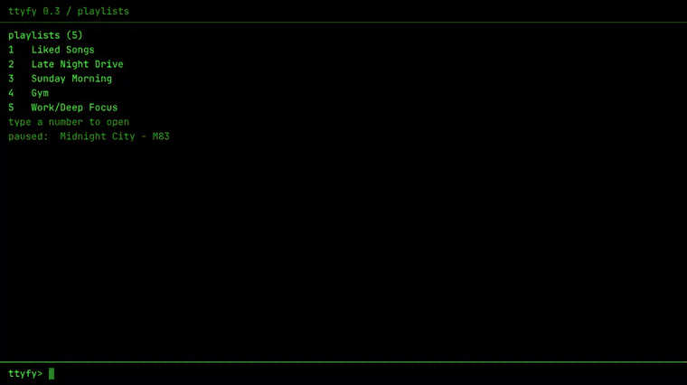
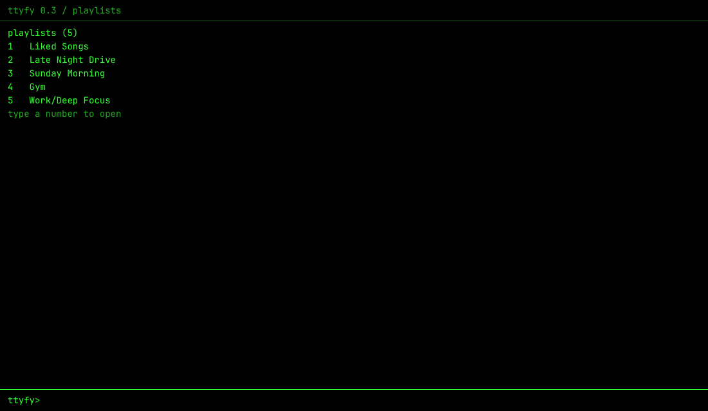
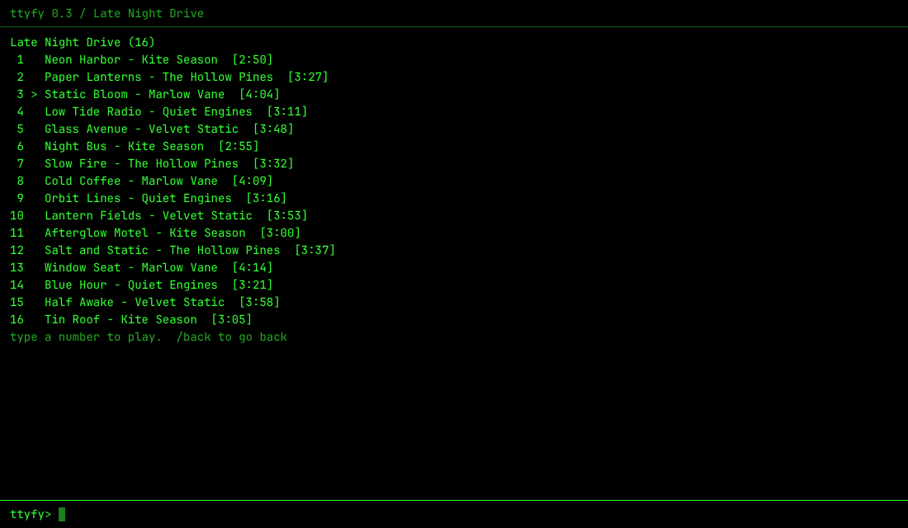
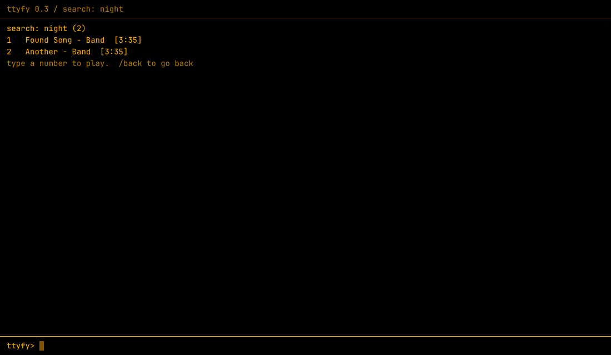
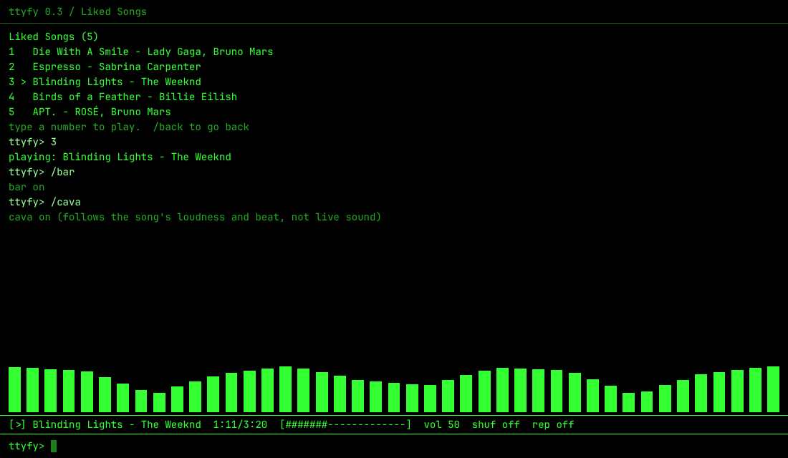

<div align="center">

# ttyfy

[](https://github.com/sjdsjadjajdjsa/ttyfy-theme/actions/workflows/check.yml)
[](CHANGELOG.md)
[](LICENSE)
[](#install)
[](https://spicetify.app)

Turn Spotify into a terminal. A theme for [Spicetify](https://spicetify.app).



</div>

Open Spotify and you get a black screen with a prompt. No covers, no buttons. You type `/playlist`, pick a number, and music plays. It runs on top of the normal Spotify app, so your account, library and playback all work as usual.

*The recording and screenshots on this page come from a test setup, not a real account. The songs and artists are real examples. The playlist names and playback are made up, and the recording has no sound.*

## What you get

- A command line for Spotify: browse playlists, search, play, queue, skip, set volume, like songs.
- Type a number to pick from any list on screen. No mouse needed.
- A one-line player bar and moving bars (`/cava`), both off until you ask for them.
- Four color schemes: green (default), amber, white and solarized. Change them on the fly with `/theme`.
- Monospace font, square corners, 1px borders, no shadows or gradients. Normal Spotify is restyled the same way if you hide the terminal.
- A built-in checker (`/debug live`) that tells you which parts work in your version of Spotify.

## Screenshots

| Your playlists | A playlist |
| --- | --- |
|  |  |

| Search, amber scheme | Player bar and bars |
| --- | --- |
|  |  |

## Install

You need [Spicetify](https://spicetify.app/docs/getting-started) set up first.

### Manual

1. Download this repo (green **Code** button, then **Download ZIP**) or clone it.
2. Copy the folder into your Spicetify Themes folder and name it `ttyfy`. To find the folder, run `spicetify path userdata` and open `Themes`. It must contain `user.css`, `theme.js` and `color.ini` directly inside.
3. Run:

```
spicetify config current_theme ttyfy
spicetify config color_scheme green
spicetify apply
```

To change the scheme later, swap `green` for `amber`, `white` or `solarized` and run `spicetify apply` again.

### Marketplace

Set `current_theme` to `marketplace`, then install ttyfy from the Themes tab. Manual and Marketplace installs are either/or, pick one. The terminal covers the Marketplace screen, so press Ctrl+` first if you want to uninstall.

## First steps

1. Type `/playlist` to see your playlists. Type a number to open one.
2. Type a song number to play it.
3. Type `/help` for the short list of commands, `/help all` for every one.

## Switching between the terminal and normal Spotify

You can go back and forth any time. The theme stays on either way.

- **Hide the terminal:** press Ctrl+` or type `/gui`. You get normal Spotify, styled like a terminal.
- **Bring it back:** press Ctrl+` again, or click the small `> ttyfy` button in the bottom-right corner. The button only shows while the terminal is hidden.
- **Choose what opens at launch:** `/start gui` opens normal Spotify, `/start terminal` opens the terminal (the default). Type `/start` to see the current setting.

## Commands

The main ones:

| Command | What it does |
| --- | --- |
| `/playlist` | list your playlists (Liked Songs first), then type a number to open one |
| `/search words` | list songs, then type a number to play one |
| `/go words` | jump to the best match in the list on screen |
| `/recent` | songs and playlists you played lately |
| `/play words` | play the first match |
| `/pause`, `/resume` | control playback |
| `/next`, `/previous` | skip |
| `/now` | the current song, with progress |
| `/help` | the short list. `/help all` shows every command, `/help play` explains one |

When a list is on screen, type its number. In a playlist list that opens the playlist, in a song list it plays the song. `/back` goes back a list, `/more` shows the next page, and `/filter words` keeps only the matching rows.

More:

| Command | What it does |
| --- | --- |
| `/album`, `/artist` | the album or top songs for the playing song. Add a number to use a song on screen |
| `/queue` | what plays next. `/queue 3` adds song 3 on screen to the queue |
| `/last` | reopen the last playlist you opened |
| `/random` | play a random playlist |
| `/vol 40`, `/vol +10` | volume |
| `/seek 1:30`, `/seek +10` | jump in the song |
| `/shuffle`, `/repeat` | toggle shuffle, cycle repeat (or `/shuffle on`, `/repeat all`) |
| `/like`, `/unlike` | save or remove the current song |
| `/theme amber` | change colors: green, amber, white, solarized, default |
| `/bar` | a one-line player bar at the bottom, off by default |
| `/cava` | moving bars that follow the song. `/cava off`, `/cava bars 24`, `/cava rows 6` |
| `/gui` | hide the terminal and show normal Spotify. Ctrl+` or the `> ttyfy` button brings it back |
| `/start gui`, `/start terminal` | choose what opens at launch |
| `/clear`, `/about` | clear the screen, version and keys |

Keys: Tab completes commands, playlist names and color names. Up and down bring back old commands. PageUp and PageDown scroll. A semicolon before a `/command` chains commands, for example `/vol 30; /next`.

About `/cava`: Spotify gives themes no live sound, so the bars are not a true spectrum. They follow the song's loudness, beat and notes from Spotify's stored analysis, played back in time with the music. A few songs have no analysis, and the bars stay flat for those.

## Color schemes

| Scheme | Look |
| --- | --- |
| `green` (default) | classic green on black |
| `amber` | amber on black |
| `white` | white on black |
| `solarized` | soft solarized colors on dark teal |

## Turn it off

To go back to normal Spotify and keep the theme files:

```
spicetify config current_theme " "
spicetify apply
```

To remove it completely, run those two lines first, then delete the `ttyfy` folder from `Themes`. If you delete the folder first, Spicetify will keep saying the theme is not found until you run the two lines.

## Troubleshooting

- **Nothing changed after `spicetify apply`.** Type `/about` in the terminal. If there is no terminal, check that `Themes/ttyfy/theme.js` exists and that `current_theme` is `ttyfy`.
- **A command fails.** Run `/debug live`. It tests each Spotify feature without changing anything and prints `ok`, `MISSING` or `FAIL` for each. Include that output when you report a problem.
- **A pop-up is hidden** (login, update). Press Ctrl+` to hide the terminal, deal with the pop-up, then press it again.
- **Something looks wrong after a Spotify update.** The few rules that depend on Spotify class names are in one commented section of `user.css`. Open an issue and say what you see.

## Notes

ttyfy is unofficial and not made by Spotify. Spotify changes its interface often, so parts of the theme can break after an update. The commands use Spicetify's API in `theme.js`, which can change too.

## Contributing

`CLAUDE.md` explains the file layout, how to add a color scheme and how to test by hand. Bug reports with the `/debug live` output are the most useful thing you can send.

## License

See [LICENSE](LICENSE).
